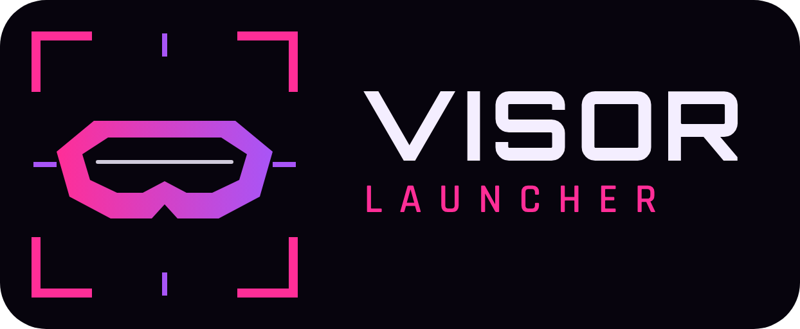
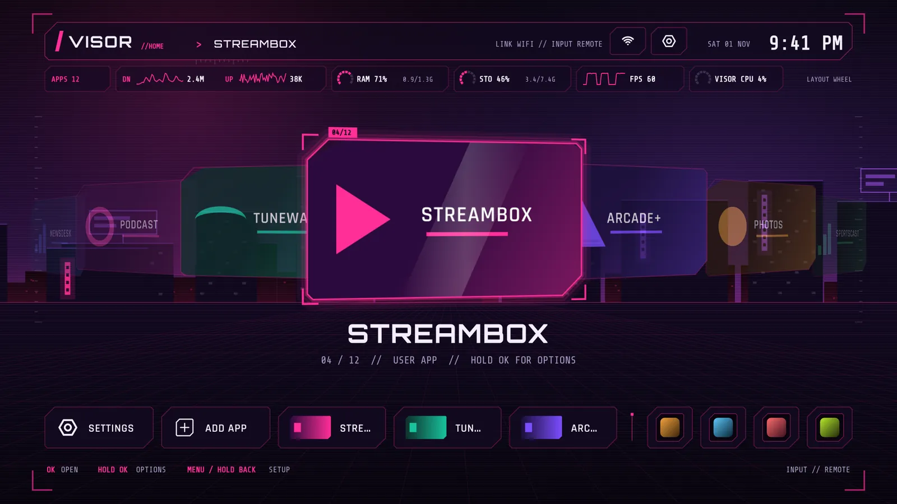
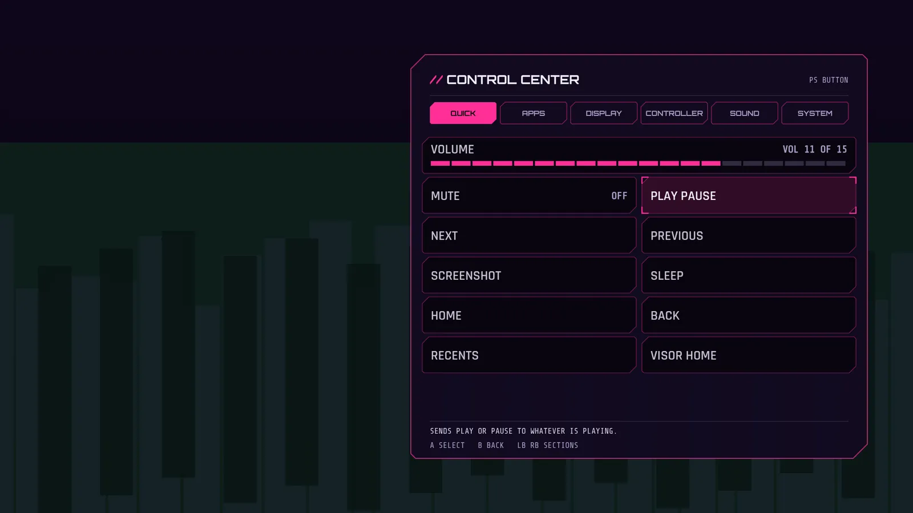
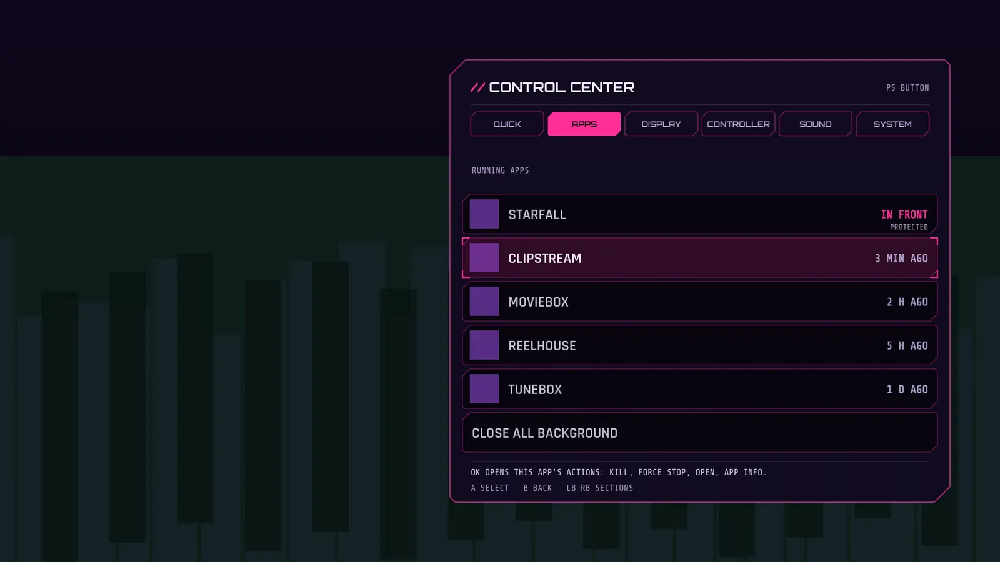
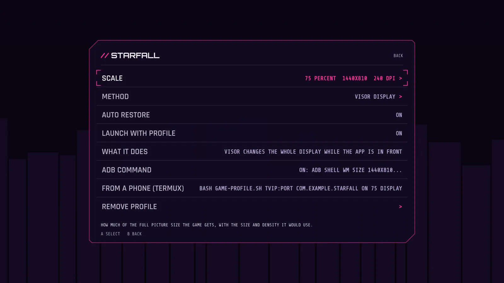
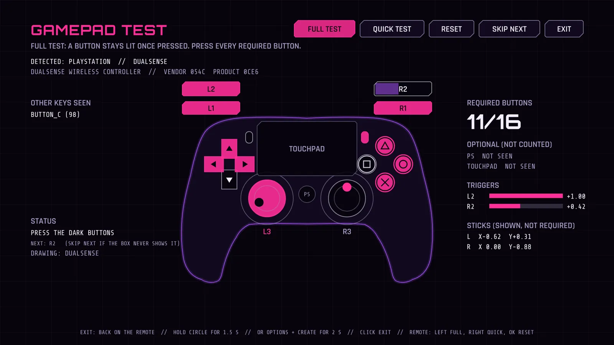
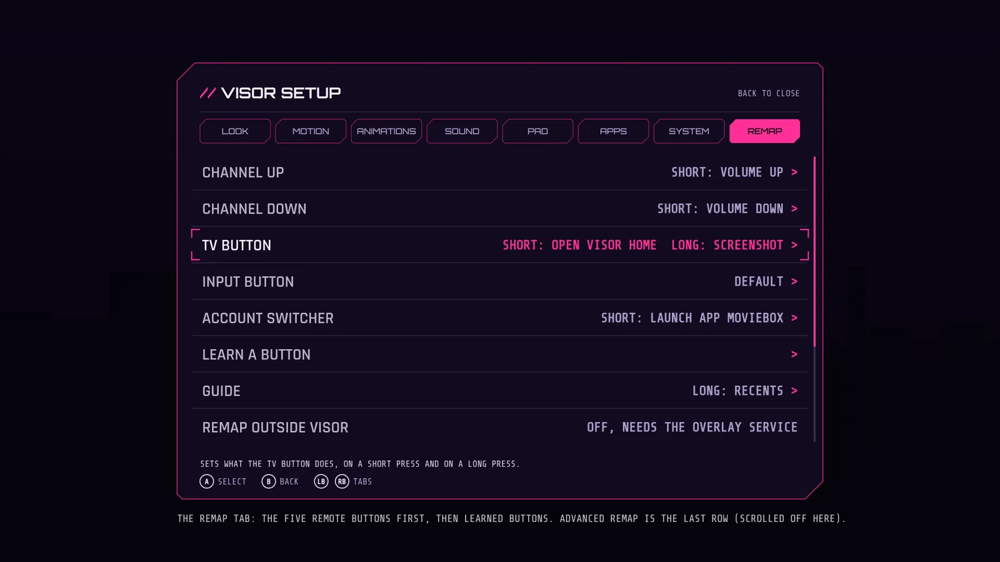
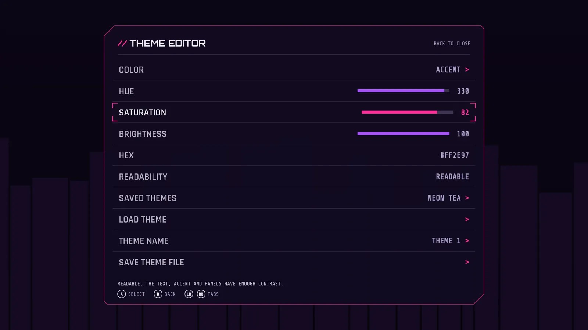
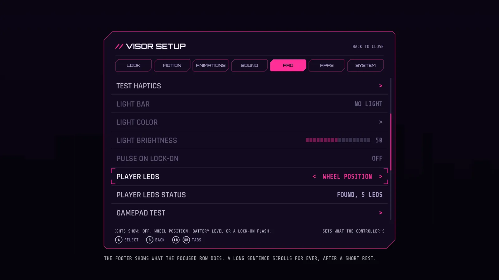

  

<h1 align="center">Visor Launcher</h1>

<b>The Android launcher for gamers</b>

  
  
  
  

*Rendered previews, not photos of a TV. Real screenshots are welcome, see [docs/screenshots.md](docs/screenshots.md).*

## What it is

Visor Launcher is a home screen for Android TV and Google TV boxes, made for people who play on a TV with a controller. It has a wheel and a grid for your apps, and a PS style menu that you can open over a running game. It has no INTERNET permission, so it cannot send anything off your TV.

**This is a public beta.** Most features were built without access to every TV: they were tested on a computer and tried on one box. Read [KNOWN-ISSUES.md](KNOWN-ISSUES.md) before you rely on it.

## Features

**The control center over your game.** Press the PS button on a controller while a game runs and a menu opens over it: volume, media keys, screenshot, a task manager, display and sound tiles. The game keeps running underneath. It needs one optional setting that you switch on once with adb. [docs/control-center.md](docs/control-center.md), [docs/ps-menu.md](docs/ps-menu.md), [docs/task-manager.md](docs/task-manager.md).

**Performance mode and EXIT GAME.** When a game starts, Visor can close the other apps' background processes to free memory, and shows the free memory before and after so you can judge it. EXIT GAME goes back home and closes the game. Android keeps some apps alive, so the gain can be small. [docs/performance-mode.md](docs/performance-mode.md).

**Game profiles.** Lower the display scale for one game, and give it its own performance mode and volume. On boxes that refuse the in-app method (the test box does) a phone helper script does it with adb. [docs/game-profiles.md](docs/game-profiles.md).

**Stick volume and touchpad volume.** Hold a key and spin the right stick, or drag a finger on the DualSense touchpad, to change the volume. [docs/stick-volume.md](docs/stick-volume.md), [docs/touchpad-volume.md](docs/touchpad-volume.md).

**The gamepad test and the gyro test.** Check every button, stick, trigger and the rumble of a controller, with a checklist and a small report. Hold the circle button to leave. The gyro test shows a 3D controller that turns with yours, and accepts your own models. [docs/gamepad-test.md](docs/gamepad-test.md), [docs/gyro-models.md](docs/gyro-models.md).

**Button remap and combos.** Make spare remote buttons run actions, and make two-button combos on a controller. Safe by design: hold Back for 6 seconds to clear it. [docs/button-remap.md](docs/button-remap.md), [docs/combos.md](docs/combos.md).

**Themes, wallpapers, a screensaver, sound and icon packs.** A theme editor with a readability check, layered and animated wallpapers (video is experimental), a screensaver, and packs you push with adb. Everything is a file, so you can share it. [docs/themes.md](docs/themes.md), [docs/wallpapers.md](docs/wallpapers.md), [docs/screensaver.md](docs/screensaver.md), [docs/sound-packs.md](docs/sound-packs.md), [docs/icon-packs.md](docs/icon-packs.md), [docs/animations.md](docs/animations.md).

**The basics.** Browse apps in a wheel or a grid, a dock with recent apps, a stats strip, Setup with a one-line help for every row, and a tutorial that teaches the controls. [docs/tutorial.md](docs/tutorial.md).

Website: https://nokoding.github.io/visor-launcher/ (when GitHub Pages is switched on for this repository; the source is in `site/`).

## Who it is for

People with an Android TV or Google TV box who use a controller, and who do not mind running a few adb commands once. It also works with just a remote, with fewer features. If you want something that installs from a store with one tap, this is not that yet.

## Requirements

- An Android TV or Google TV box with Android 9 or newer. It was tried on one onn. Full HD Streaming Device (Android 14, 1.4 GB RAM). Other boxes are unknown.
- A way to run adb: a computer, or only an Android phone with Termux.
- A controller is optional. A DualSense or an Xbox style pad is what it was built around.

## Install in 5 minutes (plus the TV setup)

Pick the guide that matches what you have. They do the same steps.

- **[I use a laptop](docs/guide-laptop.md)** (Windows, macOS or Linux)
- **[I use only my phone](docs/guide-termux.md)** (Termux)

The short version: turn on Wireless debugging on the TV, pair and connect with adb, then run `adb install -r` on the APK from the [Releases page](https://github.com/Nokoding/visor-launcher/releases). The beta is marked "Pre-release", and GitHub's "latest" link skips pre-releases, so open the list.

**Check the download.** Every release shows a SHA-256 line in its notes. Compare it with your file: `sha256sum visor-launcher-*.apk` on Linux and Termux, `shasum -a 256 visor-launcher-*.apk` on macOS, `certutil -hashfile visor-launcher-*.apk SHA256` on Windows. If they differ, do not install.

Questions: [docs/faq.md](docs/faq.md).

## Safety

- It has no INTERNET permission. The permissions it asks for are in `deck/AndroidManifest.xml`: network state, usage access for the task manager, killing background processes, deleting packages, listing apps, vibration, and an optional permission for the experimental display method.
- The optional accessibility service (the overlay) is off until you switch it on. It sees key presses and controller movement to run the menu, remaps and volume gestures. It does not read what is on the screen. See the [FAQ](docs/faq.md).
- Everything has an undo. Hold Back for 6 seconds to clear remaps. `adb shell wm size reset` and `wm density reset` fix the picture. `adb uninstall com.nokoding.deck` removes it.
- Turning off Google TV's own launcher is optional, it is the last step in the guides, and it comes with its undo. Do not do it until Visor has worked for you for a day.

## Commands

All adb commands, in one list: [docs/adb-commands.md](docs/adb-commands.md). One script runs the setup steps in one go: `deck/tools/setup-all.sh`. The helper scripts are in `deck/tools`.

Commands you can send to Visor (`adb shell am start -n com.nokoding.deck/.HomeActivity --es deck_cmd NAME`):

| NAME | What it does |
|---|---|
| reload_packs | Unpacks new sound pack zips and reloads the sound pack |
| reload_icons | Reloads custom icons and icon packs |
| open_setup | Opens Visor's Setup |
| reset_remap | Clears every button remap and combo and turns the advanced switches off, even with the D-pad broken or in the safe screen |
| open_inputs | Opens the list of TV inputs |
| reload_wallpapers | Unpacks new wallpaper pack zips and reloads the wallpaper |
| preview_screensaver | Starts the screensaver preview inside Visor |
| restore_display | Puts the display size and density back to the panel's own values |
| open_tutorial | Opens the tutorial |
| exit_game | Brings Visor to the front and closes the game performance mode remembers, like EXIT GAME in the control center. Run it with the game on screen |
| reload_themes | Rescans the themes folder after a theme file was pushed, and says how many it found |

## Documents

Guides: [docs/guide-laptop.md](docs/guide-laptop.md), [docs/guide-termux.md](docs/guide-termux.md), [docs/faq.md](docs/faq.md), [docs/adb-commands.md](docs/adb-commands.md).

Features:
- [docs/tutorial.md](docs/tutorial.md): the tutorial and TRY IT steps.
- [docs/control-center.md](docs/control-center.md): the PS style menu as a control center.
- [docs/ps-menu.md](docs/ps-menu.md): the menu over other apps.
- [docs/task-manager.md](docs/task-manager.md): the task manager.
- [docs/performance-mode.md](docs/performance-mode.md): performance mode and EXIT GAME.
- [docs/game-profiles.md](docs/game-profiles.md): game profiles.
- [docs/button-remap.md](docs/button-remap.md): button remap, with the list of button codes.
- [docs/combos.md](docs/combos.md): combos.
- [docs/touchpad-volume.md](docs/touchpad-volume.md): touchpad volume.
- [docs/stick-volume.md](docs/stick-volume.md): stick volume.
- [docs/gamepad-test.md](docs/gamepad-test.md): the gamepad and gyro tests.
- [docs/gyro-models.md](docs/gyro-models.md): the 3D controller models.
- [docs/animations.md](docs/animations.md): animations.
- [docs/screensaver.md](docs/screensaver.md): the screensaver.

Packs and looks:
- [docs/themes.md](docs/themes.md): the theme editor and theme files.
- [docs/wallpapers.md](docs/wallpapers.md): wallpapers, video, and the phone upload page.
- [docs/sound-packs.md](docs/sound-packs.md): sound packs.
- [docs/icon-packs.md](docs/icon-packs.md): icon packs.

Project: [docs/screenshots.md](docs/screenshots.md) (real screenshots wanted), [KNOWN-ISSUES.md](KNOWN-ISSUES.md), [CHANGELOG.md](CHANGELOG.md), [CONTRIBUTING.md](CONTRIBUTING.md), [SECURITY.md](SECURITY.md), [CODE_OF_CONDUCT.md](CODE_OF_CONDUCT.md).

## Contributing

Bug reports with your TV, controller and steps are the most useful thing right now, because most features were tried on one box. Code and docs are welcome, see [CONTRIBUTING.md](CONTRIBUTING.md) for how to build and test. Build and tests need no device.

## Licence

Code: MIT ([LICENSE](LICENSE)). Documentation and images: CC BY 4.0 ([LICENSE-DOCS.md](LICENSE-DOCS.md)). Fonts (Orbitron, Rajdhani, Share Tech Mono): SIL Open Font License ([NOTICE](NOTICE)). The logo and the controller drawings are original work of this project.

## Trademarks

Visor Launcher is not affiliated with or endorsed by Google, Sony, Microsoft or Valve. Android, Android TV, Google TV, PlayStation, DualSense, Xbox and Steam Deck are trademarks of their owners and are used here as plain text names only. Visor is not related to the Steam Deck or to any hardware or software that is also called Visor.
