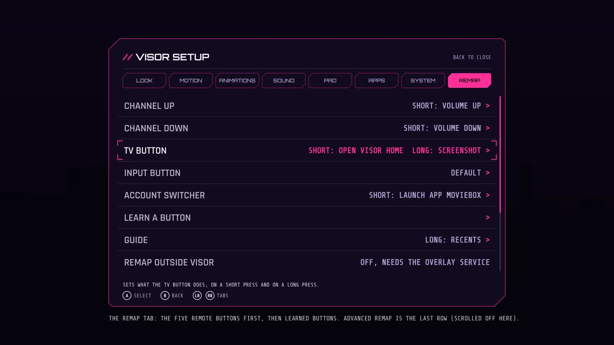
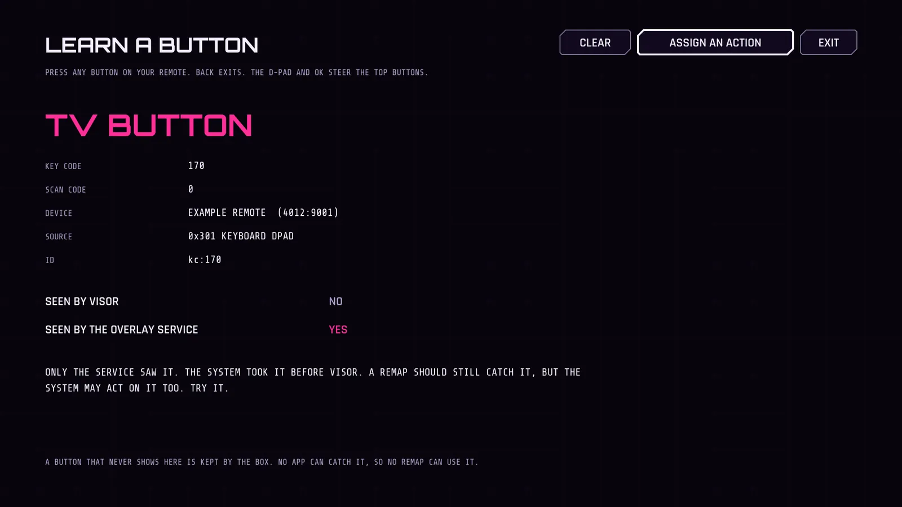

# Button remap

New in 2.6. The spare buttons on your remote can run what you want. Channel up and down, TV, input and the account switcher are the ones you asked for, and any other button the remote has (color buttons, guide, info) works the same way. A short press and a long press each get an action: open an app, go Home, take a screenshot, change the volume, open Visor's PS menu and more.



Inside Visor this works with nothing else turned on. In other apps it needs the same accessibility service as the PS menu (PsService), which you switch on with one adb command from your phone, see [ps-menu.md](ps-menu.md). And it only works for buttons the box really hands to an app. Setup tells you which, see Learn a button below. Visor won't pretend otherwise.

## What a remap can and cannot do

Android gives an app no way to press another button for you. So a remap can't make the TV button "act as" the Home button. It can only run an action: the list below includes Home, Back, Recents and the others, but each one is Visor doing the job, not a key press. Two things follow.

- A remapped button stops doing its old job. The old job isn't kept for you to fall back on.
- Inside Visor only, there is one exception. Visor reads its own keys, so it can read one button as another there (swap OK and Back, swap left and right for a left handed layout). Those are the INSIDE VISOR actions in advanced mode. In every other app the button keeps its normal job.

Newer Android does have something close: on Android 13 and newer an accessibility service can ask the system to send a D-pad key (GLOBAL_ACTION_DPAD_UP and its four friends, new in API 33, and GLOBAL_ACTION_KEYCODE_HEADSETHOOK in API 31). The system sends the key, not the app. Visor 2.6 doesn't use them. See the decisions at the end.

## The REMAP tab

Setup has an eighth tab, REMAP. The panel gets 120 px wider with eight tabs so the tab names still fit.

| Row | What it does |
|---|---|
| CHANNEL UP, CHANNEL DOWN, TV BUTTON, INPUT BUTTON, ACCOUNT SWITCHER | The five buttons, always first. OK opens the button's page. The right side shows what it does now |
| LEARN A BUTTON | Press any button to see what it is and who can catch it |
| (learned buttons) | Any other button you assigned through LEARN A BUTTON, with its name |
| REMAP OUTSIDE VISOR | ON when the overlay service runs, so remaps also work in other apps. OFF otherwise |
| REMAP IN GAMES | OFF (default) or ON, see below |
| RESET ALL REMAPS | Removes every remap and turns the advanced switches off. Press OK twice |
| ADVANCED REMAP | The system buttons, behind a warning. Always the last row |

A button's page has SHORT PRESS, LONG PRESS, CLEAR THIS BUTTON and WHERE IT WORKS. A long press is a hold of about half a second (500 ms). There is no double press in this version. Each row in the action list has its sentence in the help line at the bottom, like every other row in Setup.

### The actions

| Action | What it does | Needs the service outside Visor |
|---|---|---|
| DEFAULT | Leaves the button to the system. On a long press the list calls it SAME AS SHORT PRESS | no |
| DO NOTHING | Swallows the button | yes (to catch it at all) |
| LAUNCH APP | Opens an app you pick from a list of every launchable app, sideloaded ones too | yes |
| OPEN VISOR HOME | Brings Visor's home screen forward | yes |
| OPEN VISOR PS MENU | Opens Visor's PS menu. Over other apps it uses the overlay, so it needs the service | yes |
| OPEN VISOR SETUP | Opens Setup | yes |
| HOME, BACK, RECENTS, QUICK SETTINGS, POWER MENU, SCREENSHOT | Android's global actions, done by the service | yes |
| PREVIOUS APP | The app you used before this one, from the apps you opened with Visor (its recents list). Nothing happens if Visor has seen none | yes |
| MEDIA PLAY PAUSE, MEDIA NEXT, MEDIA PREVIOUS, MEDIA STOP | Sent to the active media session with AudioManager.dispatchMediaKeyEvent | yes |
| VOLUME UP, VOLUME DOWN, MUTE | AudioManager, with the system volume bar | yes |
| ANDROID SETTINGS | Opens the box's settings | yes |
| OPEN INPUT PICKER | Visor's own list of TV inputs (the HDMI inputs and so on). Hidden when Visor finds none, see below | yes |

"Needs the service outside Visor" means that without it the action only runs for a button pressed inside Visor, because the button never reaches Visor from another app.

How the two presses combine:

- Only a short press set: the action runs the moment you press.
- A long press set too: the short press waits for you to let go, so Visor can tell the two apart. Let go before half a second and the short action runs. Hold and the long action runs at half a second, once.
- A long press set and the short press left at DEFAULT: the short press then does nothing. Android has no way to hand a held back press to the system afterwards, so DEFAULT can't be kept. The page says so.
- Holding a button doesn't repeat its action. One press, one action. The same button can't fire twice within 120 ms.

OPEN INPUT PICKER: Android has no public "pick an input" screen to call, and Google TV's own panel has no intent to start. So Visor uses its own list, the one the home screen's inputs chip opens (TvInputManager passthrough inputs, found when Visor scans the box). The row shows only when that list isn't empty, since a picker with nothing in it would be a dead row. Remapping to it from another app brings Visor forward with the list open (deck_cmd open_inputs). Whether the box lists any input has not been seen on the real box.

## Learn a button

LEARN A BUTTON, "PRESS A BUTTON ON YOUR REMOTE". It works with any button, including ones this version has never heard of.



It shows the button's name, key code, scan code, the device's name with vendor and product id, the source, and an id (the name Visor saves the rule under). Then two flags:

- SEEN BY VISOR. The key reached Visor's own window.
- SEEN BY THE OVERLAY SERVICE. The key reached the accessibility key filter. The service has to be on for this. If it's off the screen says so and shows the command from your phone (the same one as the PS menu), plus where the by hand version is (Setup, PAD, SHOW ENABLE COMMANDS).

Reading the two flags:

| Visor | Service | Meaning |
|---|---|---|
| yes | yes | Both saw it. A remap can catch it in every app |
| no | yes | The service saw it, the system took it before Visor. A remap should still catch it, but the system may act on it too. Try it |
| yes | no (service on) | Only Visor's window got it. The key filter didn't. The remap works inside Visor only |
| yes | no (service off) | Turn the service on to find out |
| no | no | You'd see nothing at all. If a button never shows up, the box keeps it for itself and no app can use it |

ASSIGN AN ACTION opens that button's page. A button Visor doesn't know is named by its key code ("KEY 345"). A button with key code 0 (KEYCODE_UNKNOWN, which some vendor buttons for apps send) is named by its scan code plus the device's vendor and product id ("SCAN 233 (4012:9001)"), so the same scan code on a second device is a different button. It shows up in the list under the five.

While this screen is open, the service takes nothing, so every button reaches Visor as it would with no remap. The D-pad and OK steer the top buttons here, so they can't be learned (they're in ADVANCED REMAP). Back leaves. The screen has no animation, so Reduce effects needs nothing special.

If the button is one that can never be remapped (Power, the PS button, a game button, a typing key) the screen says why, and ASSIGN won't open it.

## Advanced remap

ADVANCED REMAP is the last row. It opens a full screen warning in plain words: what can go wrong, that the D-pad and OK can stop working, and how to get out. You continue by holding OK (or A on a controller) for 3 seconds. Let go and it starts over. Back or CANCEL leaves with nothing changed.

Then the system buttons appear: Up, Down, Left, Right, OK, Back, Menu, the assistant keys, media keys, volume keys, mute and the TV, box and receiver power and input keys. The same page, SHORT PRESS and LONG PRESS, with two more things at the top and bottom:

- SYSTEM WIDE NAVIGATION REMAP, OFF. Turning it ON opens a second, stronger warning (hold 5 seconds).
- SWAP OK AND BACK IN VISOR and SWAP LEFT AND RIGHT IN VISOR. One press sets both keys. They only change Visor's own screens.
- TURN OFF ADVANCED REMAP removes every system button rule and locks it again.

The rules, applied in the decision code (RemapGate), not just hidden in the screens:

| Button | Rule |
|---|---|
| Menu, assistant, media, volume | Need the advanced unlock. Then they remap in every app, no second switch |
| D-pad, OK, Back (and Enter and Escape) inside Visor | Need the advanced unlock. Then they can swap with another navigation key or run an action |
| D-pad, OK, Back in any other app | Need the unlock and SYSTEM WIDE NAVIGATION REMAP. With it off they pass through untouched |
| INSIDE VISOR actions | Work inside Visor only. Anywhere else the button keeps its normal job |
| Power, sleep, the PS button, game buttons, typing keys | Never remappable, whatever is saved |
| Home | Advanced, experimental, off by default, see REMAP HOME below |

A remap saved for a button that fails these rules is simply ignored. That includes hand edited data.

## Where remaps work

- Inside Visor: always, from Visor's own window.
- In other apps: while the overlay service runs and Visor knows which app is in front. Until the first app change after the service starts, Visor doesn't know, so it leaves every button alone.
- In games: not by default. Apps on the PS pass-through list (the games, plus anything you flipped, see ps-menu.md) get every button untouched. REMAP IN GAMES, ON turns that off.
- The service never takes a button it has no rule for, and never a protected one.

Visor is the one reading its own keys, so while Visor is in front the service passes every button and Visor's own window decides. One of the two decides for each key, never both.

## Never stuck

You can't use a computer, so every way out works from the TV or a phone.

- Hold Back for 6 seconds, in Visor or in any app (service on). That removes every remap of the D-pad, OK and Back and turns SYSTEM WIDE NAVIGATION REMAP off. It works even if Back itself is remapped to DO NOTHING, because the timer watches the physical button. It's the first step of the decision, before any rule is looked at, and while it stands no navigation button is taken at all. Other remaps stay.
- RESET ALL REMAPS in the REMAP tab, press OK twice. Everything off.
- From a phone, with Visor installed:

```
adb shell am start -n com.nokoding.deck/.HomeActivity --es deck_cmd reset_remap
```

  It needs no D-pad, and it works in Visor's safe screen too. It's one of the short list of deck_cmd names Visor accepts and only touches Visor's own settings.
- Home always works unless you turned on REMAP HOME (2.17, below). The escape does not rely on it: five quick Home presses give it back, and so do Back held for 6 seconds and RESET ALL REMAPS.
- The service never takes a button it has no rule for. An error in the remap path drops every half pressed button and lets the key through.
- A press the service took ends in the service (its release is taken too), and a press that started in the app ends in the app, so a game never sees half a press.
- To stop remaps in other apps without deleting the rules, turn the service off with the PS menu's off command (bash deck/tools/enable-ps-overlay.sh TVIP:PORT off). OVERLAY CAPTURE only decides the PS button, it doesn't switch remaps off.

## Which buttons the remote sends (not known yet)

Nobody has pressed these buttons on the real onn remote with this build. What follows is what is known from the Android platform and what isn't.

Known, from android.jar API 34 (checked by tools/check-keycodes.sh, which compares every line of the table below with the jar and prints the mismatches):

- KEYCODE_CHANNEL_UP is 166, CHANNEL_DOWN 167, TV 170, TV_INPUT 178, PROFILE_SWITCH 288, GUIDE 172, INFO 165, PROG_RED, GREEN, YELLOW and BLUE 183 to 186, LAST_CHANNEL 229, DVR 173, BOOKMARK 174, CAPTIONS 175, SETTINGS 176, TV_DATA_SERVICE 230, TV_NUMBER_ENTRY 234, ALL_APPS 284, APP_SWITCH 187, ASSIST 219, VOICE_ASSIST 231. All as in the spec.
- PROFILE_SWITCH is API 29 (the spec said 30). ALL_APPS is API 28.
- The jar has 317 KEYCODE_ constants. The table below names the 94 that matter here. `tools/check-keycodes.sh SDK --list` prints all of them.

Not known:

- Which key code the remote's CHANNEL, TV, INPUT and account buttons really send. The names say TV is KEYCODE_TV, input is KEYCODE_TV_INPUT and the account switcher is KEYCODE_PROFILE_SWITCH. That's a guess from the names. A remote can send a different code, send code 0 with a scan code, or send nothing to the box at all because the button is an infrared or HDMI-CEC button for the TV. That's what LEARN A BUTTON is for.
- Whether the system takes any of them before the service sees them. Read from the platform sources:
  - AccessibilityInputFilter only passes a key event on to services if the event carries FLAG_PASS_TO_USER and comes from a device whose source includes SOURCE_KEYBOARD (read in the AOSP main branch). A button the policy handles without passing it on, or a device that reports no keyboard source (HDMI-CEC keys come as SOURCE_HDMI, which has no keyboard bit, which is an inference), never reaches the service.
  - InputDispatcher::notifyKey calls PhoneWindowManager's interceptKeyBeforeQueueing first and the input filter second (read in the Android 4.2 source, and the structure is the same in newer ones as far as I remember, not re-read for 14). The spec said the filter runs before the system's own key policy. At the queueing step that's the other way round. What the filter does come before is interceptKeyBeforeDispatching, the later step where the system keeps Home, Menu, the app switch and the assistant keys for itself, and where an app that gets the key would see it. So a button that only gets handled at that later step is catchable. A button that gets handled at the queueing step (power, sleep, wake, the call keys and some media or volume handling, from memory) isn't. Which of the five are in that second group on this box is unknown.
- Whether the box delivers the PS button was already an open question from 2.4, and the answer decides how much the whole service is worth on this box.

## How it works

- RemapKey (pure) names a button: "kc:166" or "sc:233:4012:9001", packed into one long inside the key filter so a key press allocates nothing. It holds the table of known buttons and their classes.
- RemapAction (pure) is the action list, with the stable ids that get saved and the help sentences.
- RemapTable (pure) is the saved data and a lookup. SharedPreferences, one entry per button, named `rm:kc:166`, one line each: `v1|short_id|short_arg|long_id|long_arg|label`. Three switches next to them: rmAdv, rmNav, rmGames. Anything that doesn't read back is dropped, a protected button's entry is dropped, at most 300 rules are kept, and an unknown action id reads as DEFAULT.
- RemapGate (pure) holds decide(), the one function that answers "take it, and run what" for a button, a kind of press (first press, short, long, escape), the app in front, the rules, the switches, the pass-through list and the escape state. Around it sits the press tracking: pairs stay whole, a taken button waits for its release or 500 ms, the 6 second Back timer, the 120 ms bounce guard, six press slots (a seventh button at once is left alone) and a 30 second sweep for presses that never ended.
- RemapLearn (pure) merges what the window and the service each saw, and writes the lines on the learn screen. RemapHold is the 3 and 5 second hold timer.
- HomeActivity.dispatchKeyEvent asks RemapGate for keys while Visor is in front. PsService.onKeyEvent asks a second RemapGate for keys while another app is in front. The accessibility key filter sends no key repeats, so long presses and the escape come from a timer on the main handler. Both run on the main thread, no locks.
- RemapRunner does the parts both share: media and volume through AudioManager, launching an app, Android Settings.
- Actions in the service: performGlobalAction for HOME, BACK, RECENTS, QUICK SETTINGS, POWER MENU and SCREENSHOT (no extra flag in the service config), startActivity for the rest. Like launching from the PS menu, a background start can be blocked by Android. Visor watches for the app to come forward and says so if not.
- The service config is unchanged. No new permission and no change to the manifest except the version.

## Limits

- Not tried on a real TV yet, see [KNOWN-ISSUES.md](../KNOWN-ISSUES.md). That includes which buttons the onn remote sends.
- Android gives no key injection. A remap runs an action, it never presses another button for you.
- Outside Visor it needs the accessibility service, so an adb command once, and again if a Google TV update resets the enabled services.
- A button the system handles before the key filter can't be caught at all.
- A short press can't be left to the system when a long press is set. The system gets neither.
- PREVIOUS APP only knows the apps you opened with Visor. Apps you started some other way aren't in the list. If Visor's recents source is set to system usage, PREVIOUS APP still uses Visor's own list.
- LAUNCH APP and the other starts from the background can be refused by Android on some versions, see the PS menu notes.
- The first app change after the service starts must happen before the service knows who is in front.
- One remap per button and press kind. No double press, no combinations.
- A remap on a button that isn't in the list but sends key code 0 is tied to the scan code and the device. A different remote gets its own entry.

## Troubleshooting

- A button never shows on the learn screen: the box keeps it. Nothing in an app can change that.
- It shows with SEEN BY THE OVERLAY SERVICE: NO and the service is on: the key filter didn't get it. The remap works inside Visor only.
- A remap works in Visor and not in another app: REMAP OUTSIDE VISOR says OFF, or the app is a game (REMAP IN GAMES), or the app change hasn't happened yet.
- A long press does nothing: check the short press isn't running first. With only a short press set it acts at once and the hold means nothing.
- Navigation is broken: hold Back for 6 seconds, or use the reset command above.
- Visor says it could not run an action: for SCREENSHOT, RECENTS and the other global actions the service has to be on. For LAUNCH APP the app may have been removed or Android refused the start.

## The buttons Visor names

Every button in the table has a name, a class and a sentence in the help line. The class says where it appears: standard buttons appear in the REMAP tab and the learn screen, advanced ones behind ADVANCED REMAP, navigation ones behind it too plus the system wide switch, and "never" ones can't be remapped.

| Code | Android constant | Visor calls it | Class |
|---|---|---|---|
| 3 | KEYCODE_HOME | HOME | never |
| 4 | KEYCODE_BACK | BACK | navigation |
| 19 | KEYCODE_DPAD_UP | UP | navigation |
| 20 | KEYCODE_DPAD_DOWN | DOWN | navigation |
| 21 | KEYCODE_DPAD_LEFT | LEFT | navigation |
| 22 | KEYCODE_DPAD_RIGHT | RIGHT | navigation |
| 23 | KEYCODE_DPAD_CENTER | OK | navigation |
| 24 | KEYCODE_VOLUME_UP | VOLUME UP | advanced |
| 25 | KEYCODE_VOLUME_DOWN | VOLUME DOWN | advanced |
| 26 | KEYCODE_POWER | POWER | never |
| 66 | KEYCODE_ENTER | ENTER | navigation |
| 82 | KEYCODE_MENU | MENU | advanced |
| 84 | KEYCODE_SEARCH | SEARCH | advanced |
| 85 | KEYCODE_MEDIA_PLAY_PAUSE | PLAY PAUSE | advanced |
| 86 | KEYCODE_MEDIA_STOP | STOP | advanced |
| 87 | KEYCODE_MEDIA_NEXT | NEXT TRACK | advanced |
| 88 | KEYCODE_MEDIA_PREVIOUS | PREVIOUS TRACK | advanced |
| 89 | KEYCODE_MEDIA_REWIND | REWIND | advanced |
| 90 | KEYCODE_MEDIA_FAST_FORWARD | FAST FORWARD | advanced |
| 110 | KEYCODE_BUTTON_MODE | PS BUTTON | never |
| 111 | KEYCODE_ESCAPE | ESCAPE | navigation |
| 126 | KEYCODE_MEDIA_PLAY | PLAY | advanced |
| 127 | KEYCODE_MEDIA_PAUSE | PAUSE | advanced |
| 130 | KEYCODE_MEDIA_RECORD | RECORD | advanced |
| 160 | KEYCODE_NUMPAD_ENTER | NUMPAD ENTER | navigation |
| 164 | KEYCODE_VOLUME_MUTE | MUTE BUTTON | advanced |
| 165 | KEYCODE_INFO | INFO | standard |
| 166 | KEYCODE_CHANNEL_UP | CHANNEL UP | standard |
| 167 | KEYCODE_CHANNEL_DOWN | CHANNEL DOWN | standard |
| 168 | KEYCODE_ZOOM_IN | ZOOM IN | standard |
| 169 | KEYCODE_ZOOM_OUT | ZOOM OUT | standard |
| 170 | KEYCODE_TV | TV BUTTON | standard |
| 171 | KEYCODE_WINDOW | WINDOW | standard |
| 172 | KEYCODE_GUIDE | GUIDE | standard |
| 173 | KEYCODE_DVR | DVR | standard |
| 174 | KEYCODE_BOOKMARK | BOOKMARK | standard |
| 175 | KEYCODE_CAPTIONS | CAPTIONS | standard |
| 176 | KEYCODE_SETTINGS | SETTINGS BUTTON | standard |
| 177 | KEYCODE_TV_POWER | TV POWER | advanced |
| 178 | KEYCODE_TV_INPUT | INPUT BUTTON | standard |
| 179 | KEYCODE_STB_POWER | BOX POWER | advanced |
| 180 | KEYCODE_STB_INPUT | BOX INPUT | advanced |
| 181 | KEYCODE_AVR_POWER | RECEIVER POWER | advanced |
| 182 | KEYCODE_AVR_INPUT | RECEIVER INPUT | advanced |
| 183 | KEYCODE_PROG_RED | RED BUTTON | standard |
| 184 | KEYCODE_PROG_GREEN | GREEN BUTTON | standard |
| 185 | KEYCODE_PROG_YELLOW | YELLOW BUTTON | standard |
| 186 | KEYCODE_PROG_BLUE | BLUE BUTTON | standard |
| 187 | KEYCODE_APP_SWITCH | APP SWITCH | standard |
| 207 | KEYCODE_CONTACTS | CONTACTS | standard |
| 208 | KEYCODE_CALENDAR | CALENDAR | standard |
| 209 | KEYCODE_MUSIC | MUSIC | standard |
| 210 | KEYCODE_CALCULATOR | CALCULATOR | standard |
| 219 | KEYCODE_ASSIST | ASSISTANT | advanced |
| 222 | KEYCODE_MEDIA_AUDIO_TRACK | AUDIO TRACK | standard |
| 223 | KEYCODE_SLEEP | SLEEP | never |
| 224 | KEYCODE_WAKEUP | WAKEUP | never |
| 226 | KEYCODE_MEDIA_TOP_MENU | TOP MENU | standard |
| 229 | KEYCODE_LAST_CHANNEL | LAST CHANNEL | standard |
| 230 | KEYCODE_TV_DATA_SERVICE | TV DATA SERVICE | standard |
| 231 | KEYCODE_VOICE_ASSIST | VOICE ASSISTANT | advanced |
| 233 | KEYCODE_TV_TELETEXT | TELETEXT | standard |
| 234 | KEYCODE_TV_NUMBER_ENTRY | TV NUMBER ENTRY | standard |
| 256 | KEYCODE_TV_CONTENTS_MENU | CONTENTS MENU | standard |
| 257 | KEYCODE_TV_MEDIA_CONTEXT_MENU | MEDIA CONTEXT MENU | standard |
| 259 | KEYCODE_HELP | HELP | standard |
| 272 | KEYCODE_MEDIA_SKIP_FORWARD | SKIP FORWARD | advanced |
| 273 | KEYCODE_MEDIA_SKIP_BACKWARD | SKIP BACKWARD | advanced |
| 276 | KEYCODE_SOFT_SLEEP | SOFT SLEEP | never |
| 284 | KEYCODE_ALL_APPS | ALL APPS | standard |
| 285 | KEYCODE_REFRESH | REFRESH | standard |
| 286 | KEYCODE_THUMBS_UP | THUMBS UP | standard |
| 287 | KEYCODE_THUMBS_DOWN | THUMBS DOWN | standard |
| 288 | KEYCODE_PROFILE_SWITCH | ACCOUNT SWITCHER | standard |
| 289 | KEYCODE_VIDEO_APP_1 | VIDEO APP 1 | standard |
| 290 | KEYCODE_VIDEO_APP_2 | VIDEO APP 2 | standard |
| 291 | KEYCODE_VIDEO_APP_3 | VIDEO APP 3 | standard |
| 292 | KEYCODE_VIDEO_APP_4 | VIDEO APP 4 | standard |
| 293 | KEYCODE_VIDEO_APP_5 | VIDEO APP 5 | standard |
| 294 | KEYCODE_VIDEO_APP_6 | VIDEO APP 6 | standard |
| 295 | KEYCODE_VIDEO_APP_7 | VIDEO APP 7 | standard |
| 296 | KEYCODE_VIDEO_APP_8 | VIDEO APP 8 | standard |
| 297 | KEYCODE_FEATURED_APP_1 | FEATURED APP 1 | standard |
| 298 | KEYCODE_FEATURED_APP_2 | FEATURED APP 2 | standard |
| 299 | KEYCODE_FEATURED_APP_3 | FEATURED APP 3 | standard |
| 300 | KEYCODE_FEATURED_APP_4 | FEATURED APP 4 | standard |
| 301 | KEYCODE_DEMO_APP_1 | DEMO APP 1 | standard |
| 302 | KEYCODE_DEMO_APP_2 | DEMO APP 2 | standard |
| 303 | KEYCODE_DEMO_APP_3 | DEMO APP 3 | standard |
| 304 | KEYCODE_DEMO_APP_4 | DEMO APP 4 | standard |
| 313 | KEYCODE_MACRO_1 | MACRO 1 | standard |
| 314 | KEYCODE_MACRO_2 | MACRO 2 | standard |
| 315 | KEYCODE_MACRO_3 | MACRO 3 | standard |
| 316 | KEYCODE_MACRO_4 | MACRO 4 | standard |

Any code not in this table is a standard button, so a remote with a button this version doesn't know still works. Two groups stay out: typing keys (letters, digits, punctuation, the function and numpad keys) and the gamepad buttons (A, B, X, Y, the shoulders, Start and Select and BUTTON_1 to 16).

## Decisions for you

Things I chose where the brief left it open. Say if any should change.

- Channel up and channel down are two rows, so each can have its own action. The brief said "up and down both".
- Up to 500 ms counts as a short press. Visor's own hold OK uses 550 ms, so the two thresholds differ by a little.
- A DEFAULT short press next to a long press does nothing, since DEFAULT can't be kept.
- On Android 13 and newer the service could also make the system press D-pad keys for you (GLOBAL_ACTION_DPAD_*), which would allow system wide "this button acts as Up" actions. Not added. The onn box's Android version decides whether it's worth it.
- The learn screen won't learn the D-pad or OK, because they steer its top buttons.

## Combos (2.9)

Two buttons held together can run an action too. That is a separate list in Setup, REMAP, COMBOS and has its own page: [combos.md](combos.md). RESET ALL REMAPS and the reset_remap adb command remove the combos as well.

## Home in advanced remap (2.17, experimental)

Until 2.16 this page said Home is handled by the system before any app sees it. That was not proven. The notes above say the accessibility key filter runs before the later step where the system keeps Home for itself, so the overlay service may well see Home. Nobody has checked on this box, and the code cannot know. So 2.17 lets you find out and, if the service sees it, remap it.

Setup, REMAP, ADVANCED REMAP has two new rows:

- **HOME KEY CHECK.** With the overlay service on, press Home on the remote and open this screen again. It says the service saw Home N times and when, or that it has not seen it. LEARN A BUTTON also reports Home when the service sees it, like any other button. If it stays empty, the box keeps Home from the service and Home stays as it is.
- **REMAP HOME.** Only works once the service has seen Home. Turning it on shows a last warning that you must hold for 5 seconds. Then the Home button appears in the advanced list. Default: not remapped.

Guards:

- Home is only taken by the overlay service's key filter, and only while REMAP HOME is on and ADVANCED REMAP is on. Inside Visor's own window nothing is taken, and with the service off nothing is taken.
- **Five Home presses within 4 seconds** pass the last one to the system and switch the Home remap off for good (the rule is removed).
- Holding Back for 6 seconds, RESET ALL REMAPS, TURN OFF ADVANCED REMAP and `deck_cmd reset_remap` also remove the Home rule and turn REMAP HOME off.

What the code cannot know without the TV: whether the service ever sees Home on the onn box, and whether Android still also sends Home to the system when the service takes it (it should not, if the service takes the key). The tests check the rules, not the box.

## Why there is no IR code system

You asked for your own IR codes that work better than Google's. It cannot be built. The onn remote talks to the box over Bluetooth. The infrared on that remote only talks to the TV (power, volume, input), and the box has no IR transmitter, so an app on the box cannot send IR. What Visor can do is catch the Bluetooth key events, which is what the remap already does. Nothing was built for IR.
