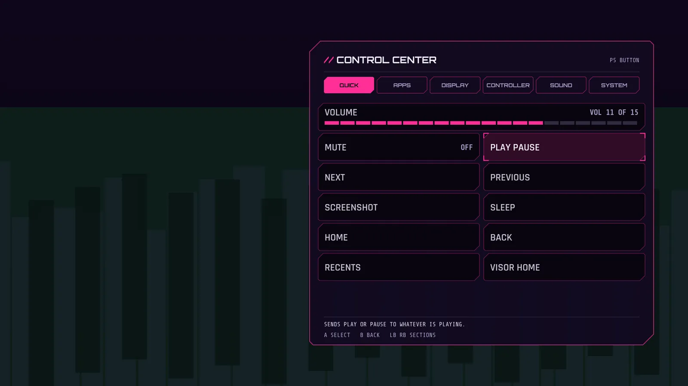

# The control center (PS menu)

New in 2.8. The PS button menu used to be one list: recent apps, volume, Setup. It is now a control center with a strip of sections and a page of tiles under each one. It looks the same inside Visor and over other apps (the overlay needs the one adb step in [ps-menu.md](ps-menu.md)).

## Moving around

- D-pad up and down move between tiles. Up from the top row goes to the section strip.
- Left and right change the section while the strip has focus, change the volume on a slider, and move between the two tiles in a row.
- L1 and R1 (LB and RB) change the section from anywhere on the page. A pointer can click a section tab.
- A or OK runs a tile, B or Back closes the menu (or leaves the app actions page first). Menu or Start opens Setup.

A toggle that is on is lit. A greyed tile needs the overlay service when you are outside Visor, and its help line says so.

## The sections

| Section | Tiles |
|---|---|
| QUICK | Volume, mute, play pause, next, previous, screenshot, sleep (the power menu), Home, Back, Recents, Visor home, EXIT GAME (goes back to Visor and closes the game, see [performance-mode.md](performance-mode.md)) |
| APPS | The task manager: recent apps and CLOSE ALL BACKGROUND, see [task-manager.md](task-manager.md) |
| DISPLAY | Game profile quick switch, RESTORE DISPLAY, reduce effects, performance mode on or off, a memory line, screensaver now |
| CONTROLLER | Gyro sway, input mode, rumble test, player LEDs, controller battery, remaps on or off |
| SOUND | Volume, sound pack, UI sounds |
| SYSTEM | Visor Setup, Android settings, power menu, restart Visor, Google TV launcher status |

Details that are easy to miss:

- Screenshot, Home, Back, Recents and the power menu are Android global actions. Only the accessibility service can press them, so they work outside Visor only when the overlay service is on. Screenshot closes the menu first so the menu is not in the picture.
- Media tiles send the key to whatever is playing media, like the 2.6 remap actions do.
- REMAPS ON is a master switch. Off turns every button remap off without deleting any of them. Setup, REMAP still shows them all.
- A few CONTROLLER and SOUND tiles (input mode, rumble test, player LEDs, sound pack) and screensaver now only work inside Visor, because they change Visor's own live state. Over another app they are greyed. Reduce effects, gyro sway, UI sounds and REMAPS ON work anywhere: the overlay writes the setting and Visor reads it when it comes to the front.
- Input mode shows the current mode. Visor chooses it by itself from the last input, so there is nothing to switch.
- Volume uses AudioManager. If the box has fixed volume (HDMI-CEC), Visor sends the volume key action instead and the box decides.

## Choosing what shows

Setup, SYSTEM, PS MENU lists the six sections. Open one to hide a tile, show it again, or move it up or down inside its section. RESET PS MENU brings everything back. Visor Setup can never be hidden, and neither can the status lines, so the menu is never empty.

Each page remembers which tile had focus.

## Cost

One overlay window, as in 2.4. The views and text pieces are built when a page opens and reused, nothing is allocated per frame, the panel opens with the same flyout as the other menus and respects Reduce effects. The cost on a box with 1.4 GB of RAM has not been measured.

## What could not be checked

- How the pages look from the couch.
- Whether the overlay stays smooth on the weak GPU with seven rows of tiles.
- Which of the global actions work on the onn box. Android decides.
