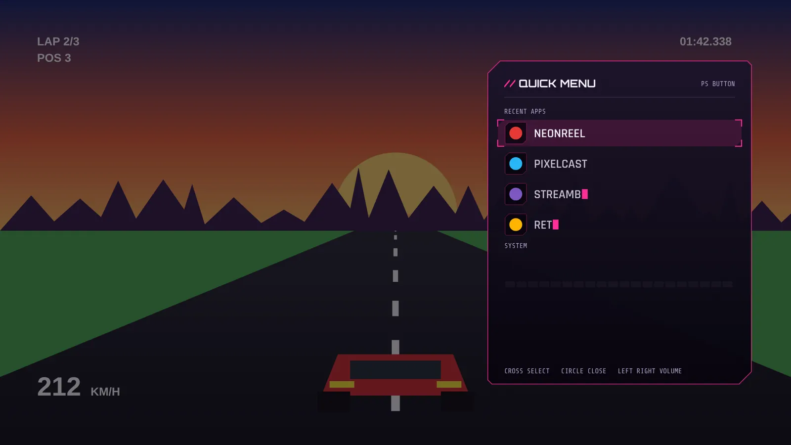

# PS menu over other apps

> From 2.8 the menu is a control center with sections and tiles. This page is about getting the PS button to reach it over other apps. What is in the menu is in [control-center.md](control-center.md), and the task manager in [task-manager.md](task-manager.md).

New in 2.4. Press the PS button in any app and Visor's quick menu slides out over it: recent apps to switch to, volume, Setup (before 2.8, see the note above for what it holds now). Games that need the PS button themselves keep it.



This needs one adb step from your phone, because Android won't let you switch it on from the TV's settings for a sideloaded app. And it only works if your box passes the PS button on at all. Setup tells you both, see Status below.

## Turn it on

From Termux on your phone, with Visor 2.4 installed and the TV paired (docs/guide-termux.md):

```
bash deck/tools/enable-ps-overlay.sh TVIP:PORT on
```

That's the whole job. The script reads the TV's list of accessibility services, adds Visor's entry if it's missing, writes the list back and reads it again to check. Anything else you run (TalkBack, a remote app) stays on. `status` shows the list, `off` removes only Visor.

By hand, if nothing else is on (check first with `adb shell settings get secure enabled_accessibility_services`, it prints `null` when the list is empty):

```
adb shell settings put secure enabled_accessibility_services com.nokoding.deck/com.nokoding.deck.PsService
adb shell settings put secure accessibility_enabled 1
```

If that first command printed something, don't use the line above, it would switch the others off. Put the old value back with `:com.nokoding.deck/com.nokoding.deck.PsService` on the end, in single quotes:

```
adb shell settings put secure enabled_accessibility_services 'OLD_VALUE:com.nokoding.deck/com.nokoding.deck.PsService'
```

Setup, PAD, SHOW ENABLE COMMANDS shows the right version for your TV, because Visor can read that list.

## Turn it off

```
bash deck/tools/enable-ps-overlay.sh TVIP:PORT off
```

By hand, only if Visor is the only service on:

```
adb shell settings delete secure enabled_accessibility_services
adb shell settings put secure accessibility_enabled 0
```

That delete clears every accessibility service on the TV, not just Visor's. With others on, write the list back without Visor's entry (the script does exactly that).

Faster, without adb: Setup, PAD, OVERLAY CAPTURE, OFF. The service stays enabled but never takes a key.

## Status

Setup, PAD has these rows:

| Row | What it says |
|---|---|
| PS BUTTON SEEN | The PS button reached Visor's own home screen at least once (from 2.1) |
| PS OVERLAY | ON (the service runs), OFF (listed, but not running) or NOT ENABLED (not in the list) |
| PS SEEN BY THE OVERLAY SERVICE | The PS button reached the service's key filter at least once |
| DOES IT WORK ON THIS BOX | The plain answer from the two rows above |
| OPENING APPS FROM THE OVERLAY | WORKS, BLOCKED BY ANDROID, or NOT TRIED YET |
| SHOW ENABLE COMMANDS | The commands above, matched to what's on your TV now |
| TEST PS OVERLAY | Opens the overlay menu right over Visor, to check the window and the animation |
| OVERLAY CAPTURE | ON or OFF. Off: the service passes every key |
| GAMES KEEP THE PS BUTTON | ON (default) or OFF, see below |
| PS BUTTON APPS | Every app with its switch |

To check the key path, turn the service on, go to the home screen and press PS once. The service sees every key before Visor does, so if PS SEEN BY THE OVERLAY SERVICE turns YES, the box delivers it. If Visor's own menu opens but the row stays NO, the box routes the key around the accessibility filter. If neither ever turns YES, the box eats the PS button before any app, and the overlay can't work on it. Visor won't pretend otherwise. Turn the service off in that case.

## Which apps keep the PS button

Each app is either VISOR (PS opens Visor's menu over it) or THE APP (the app gets the PS button, Visor doesn't touch it at all, not even the release).

- Default: apps Android marks as games keep it. Everything else is VISOR. Android marks a game with the GAME category in its manifest (ApplicationInfo.CATEGORY_GAME) or the old isGame flag. Not every game sets it, so check yours.
- GAMES KEEP THE PS BUTTON, OFF: games default to VISOR too.
- Flip one app: hold OK (or press X) on it, then PS BUTTON: VISOR or THE APP. The dock menus have the same row.
- Or Setup, PAD, PS BUTTON APPS: every launchable app with the switch. SHOW at the top filters ALL, GAMES or CHANGED. OK or A flips the focused app, left and right do too. Games carry `// GAME`, apps you flipped carry `// CHANGED`.
- Visor always takes the PS button on its own home screen, whatever the list says.

Only flips away from the default are saved, as package names in Visor's settings (psPass and psDeck). Changes apply at once, the service rebuilds its list in the background.

## Using the menu

Same menu as inside Visor, with the same flyout: the panel grows out of the right edge, the rows type in, the same ticks and sweeps, all the ANIMATIONS options and Reduce effects apply. The PS QUICK MENU switch under ANIMATIONS, SCREENS turns its animation off.

| Button | In the overlay |
|---|---|
| D-pad, left stick, L1 and R1 | Up and down |
| D-pad left and right | Volume (on the volume row) |
| A, Cross, OK | Select |
| B, Circle, Back | Close |
| PS | Close |
| Start, Menu | Open Visor's Setup |
| Home | Closes the menu, then goes home as usual |
| Volume keys | Still change the volume |

While the menu is open, the app underneath gets none of your buttons. It keeps running though: a game isn't paused unless it pauses itself.

A DualSense sends its D-pad and sticks as joystick axes, not keys. On Android 14 (the onn box) Visor asks for those only while the menu is open, then hands them straight back. On Android 13 and older that's not possible: use the remote's D-pad or L1 and R1 to move.

Picking an app starts it and closes the menu. OPEN SETUP brings Visor to the front with Setup open.

## Never stuck

- Hold PS for 4 seconds: the menu closes and Visor lets go of the app in front. The PS button goes to that app until you switch to another one.
- Home always works. Back or B closes the menu.
- A controller that disconnects closes the menu.
- If the service hits an error, it drops the menu and forgets every half pressed key, so nothing stays swallowed.
- OVERLAY CAPTURE OFF in Setup, or the off command above.

## How it works

An accessibility service is the only public way for a normal app to see a key while another app is in front. Visor's is PsService, in the same process as the home screen.

- Its config asks for key filtering and window state changes, nothing else: no screen content, no gestures, no touch exploration.
- From each window state change it keeps only the package name of the app in front, in memory. It doesn't store or log it. Visor's own overlay window and the system UI's volume and notification panels don't count as the app in front.
- `onKeyEvent` asks one small function (PsGate) whether to take the key. With the menu closed it can only take BUTTON_MODE, only from a gamepad, and only when the app in front is known, isn't Visor, isn't on the pass-through set and isn't let go by the kill switch. Every other key returns false at once. Once a press is taken, its repeats and its release are taken too, and a press that started in the app ends in the app. So no app ever sees half a press.
- The menu is the same QuickMenu view as inside Visor, in a TYPE_ACCESSIBILITY_OVERLAY window (no SYSTEM_ALERT_WINDOW permission). The window can't take key focus, so the app keeps focus and there's no focus fight; the keys arrive through `onKeyEvent`. The view, its sounds, icons and frame clock are built when the menu opens and freed when it closes.
- Launching: Android 10 and newer limit starting activities from the background. Visor starts the app while its overlay window is still visible, because "the app has a visible window" is one of Android's documented exemptions. Older versions of Android's docs also listed apps with a bound accessibility service as exempt. Neither has been tried on the onn box yet. A blocked start fails silently, so Visor watches for the app to come to the front within 2.5 seconds. If it doesn't, you get a message and Setup shows BLOCKED BY ANDROID.

PsGate and PsRules carry their own copies of Android's key codes, CATEGORY_GAME and FLAG_IS_GAME so the JVM tests can run them. Those numbers were compared with android.jar (API 34) when 2.4 was built.

## Memory

The service keeps Visor's process alive while other apps run. While the menu is closed it holds the pass-through set and the package in front. The menu, its sound pool and icons exist only while it's open, an estimated 2 MB (not measured), and go about a second after it closes. The home screen's own memory trimming is unchanged.

## Limits

- The box has to deliver the PS button. Some boxes keep it for themselves. Setup shows the evidence.
- Not checked on a real TV yet, see [KNOWN-ISSUES.md](../KNOWN-ISSUES.md).
- Android 13 and newer block enabling a sideloaded accessibility service from Settings ("restricted setting"). adb is the way.
- A Google TV update can reset the list of enabled services. Run the on command again.
- Play Protect may warn about an app that uses accessibility. Visor uses it only for the PS button.
- Until the first app change after the service starts, Visor doesn't know which app is in front, so it leaves the PS button alone.
- No rumble in the overlay menu, only sounds.
- The game marks come from each app's own manifest. Some games aren't marked.

## Troubleshooting

- PS OVERLAY says NOT ENABLED: run the on command.
- It says OFF, listed but accessibility is off: run the on command again, it sets accessibility_enabled 1.
- It says OFF, listed but not running: Android stops an accessibility service that crashed. Run off, then on.
- PS SEEN BY THE OVERLAY SERVICE stays NO: press PS on the home screen with the service ON. If it stays NO, the box doesn't hand the key to accessibility services. Nothing in an app can change that.
- The menu opens in a game that needs PS: set that game to THE APP (hold OK on it, or PS BUTTON APPS).
- An app won't open from the menu (BLOCKED BY ANDROID): open it from Visor instead. Note the box and its Android version, that's the case this check exists for.
- Everything feels slow after enabling it: turn OVERLAY CAPTURE off and check again. The filter does almost nothing per key, but that's the first thing to rule out.
