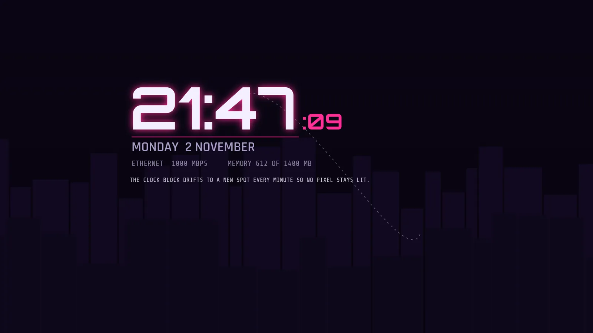

# Visor screensaver

New in 2.7. Visor has its own screensaver. Android calls it a "dream", so the code calls it DeckDream, but it is the same thing as the screensaver in your TV's settings. It shows a big clock and the date in the HUD style, with your wallpaper (or the built-in skyline) panning slowly behind it, heavily dimmed. The clock block moves to a new place every minute so no part of the screen holds a bright shape for hours.



## Try it first

Setup, LOOK, SCREENSAVER, PREVIEW SCREENSAVER starts it right now inside Visor. Any key, any pointer move, a touch or a gamepad push ends it and puts you back in Setup. From your phone:

```
adb shell am start -n com.nokoding.deck/.HomeActivity --es deck_cmd preview_screensaver
```

The preview is the same screen the real screensaver shows. It does not tell you whether the TV will start the real one, that is the next part.

## Make it the TV's screensaver

Visor's dream does nothing until Android is told to use it. Four settings are involved, and Visor's helper script writes exactly these and nothing else:

```
adb shell settings put secure screensaver_components com.nokoding.deck/com.nokoding.deck.DeckDream
adb shell settings put secure screensaver_enabled 1
adb shell settings put secure screensaver_activate_on_sleep 1
adb shell settings put system screen_off_timeout 900000
```

The last one is optional. It sets how long the TV must sit idle before the screensaver starts (900000 ms is 15 minutes). Leave it out to keep the idle time you have now.

From Termux, in one go:

```
bash deck/tools/enable-screensaver.sh TVIP:PORT on        # keep the idle time
bash deck/tools/enable-screensaver.sh TVIP:PORT on 15     # start after 15 idle minutes
bash deck/tools/enable-screensaver.sh TVIP:PORT status    # show what is set
bash deck/tools/enable-screensaver.sh TVIP:PORT off       # drop Visor's choice
```

TVIP:PORT is the same Wireless debugging address the other helper scripts use. `on` prints what it found first, so if you were using another screensaver you can put it back by hand. It writes the four settings, reads them back and stops with an error if the TV did not keep them. MINUTES must be a whole number from 1 to 120. `off` only acts when Visor's dream is the current one.

By hand, to take Visor's choice away again (Android then uses its own default screensaver):

```
adb shell settings delete secure screensaver_components
```

Setup, LOOK, SCREENSAVER, SET AS SYSTEM SCREENSAVER shows the same commands on the TV, and SCREENSAVER STATUS reads the settings back and says whether Visor's dream is the current one.

## What each setting does, from the Android 14 sources

Visor's choices come from reading the Android 14 (android14-release) source, not from guessing. Where a claim could not be checked without a device it says so.

- `screensaver_components` names the dream as `package/class`. It can hold a comma separated list and the first valid entry wins (DreamManagerService.getDreamComponentsForUser). An entry is valid when the service exists and declares the BIND_DREAM_SERVICE permission. If none is valid, Android falls back to `screensaver_default_component`. DeckDream declares that permission.
- `screensaver_enabled` must be 1 or dreams never start (PowerManagerService.canDreamLocked checks it). The Settings library (DreamBackend.isEnabled) reads it with a default from the device's config.
- `screensaver_activate_on_sleep` decides what happens when the idle time ends. PowerManagerService.shouldNapAtBedTimeLocked returns true when it is 1 (or when the device is docked and `screensaver_activate_on_dock` is 1). Only then does Android start a dream instead of turning the display off. The AOSP TV screensaver page does not write this setting, so TV builds must default it to on. Setting it to 1 explicitly is harmless and makes sure.
- The idle time is `screen_off_timeout` in the system table, in milliseconds. The AOSP TV screensaver page (TvSettings DaydreamFragment) reads and writes exactly that setting and offers 5, 15, 30, 60 and 120 minutes, with 30 minutes as its default. Its "start now" row calls DreamBackend.startDreaming().
- A third party README (Aerial Views) claims Android TV 12 and newer ignore values under 6 minutes. That is not in the AOSP sources I read, and the TV page's own shortest choice is 5 minutes. Visor's script accepts 1 to 120 and the docs here do not promise that short values work on your box.
- `adb shell cmd dreams start-dreaming` exists but needs root (DreamShellCommand.enforceCallerIsRoot). It will not work from adb shell. Use PREVIEW SCREENSAVER, or the TV's own "start now" if it has one.

## Your box and Google TV's own screensaver

The speed-up in [guide-termux.md](guide-termux.md) turned off Google TV's own screensaver app (com.google.android.apps.tv.dreamx). Visor's dream replaces it. On a normal Google TV that app is what the "Ambient mode" setting runs, and with it off that setting has nothing to show.

Plain Android TV has a screensaver page in Settings where you pick a screensaver and the start time. Google TV, since about 2023, mostly does not. The Aerial Views project says nearly all current Google TV devices have no screen for choosing a third party screensaver, and its guide uses the same adb setting as above. So on a Google TV box the adb route is the normal way, not a workaround.

Setup, LOOK, SCREENSAVER, OPEN ANDROID SCREENSAVER SETTINGS tries two things in order: Android's own DREAM_SETTINGS screen, and the AOSP TV settings screensaver page (com.android.tv.settings, DaydreamActivity, which is exported in the AOSP manifest). It does not check first whether either exists, because checking would need a new line in Visor's manifest. If neither opens, the row greys out and says NOT ON THIS TV. Use the adb commands then.

To go back to Google's screensaver, turn its app on again and point the setting at it:

```
adb shell pm enable com.google.android.apps.tv.dreamx
adb shell settings put secure screensaver_components com.google.android.apps.tv.dreamx/.service.Backdrop
```

The class name in the second line comes from the Aerial Views guide, not from your box. Check it first with `adb shell settings get secure screensaver_components` before you changed anything (the helper script prints it when you run `on`).

## Use someone else's screensaver

Any app that declares a DreamService can be the screensaver. Find its component name, then set it the same way:

```
adb shell cmd package query-services -a android.service.dreams.DreamService
adb shell settings put secure screensaver_components PACKAGE/CLASS
adb shell settings put secure screensaver_enabled 1
adb shell settings put secure screensaver_activate_on_sleep 1
```

The first command lists every installed dream (it is Android's package manager shell command, `cmd package query-services`, and it was not run here). Use the package and class it prints. If a dream is also an app with its own settings, open that app and set it up first. `settings get secure screensaver_components` shows what is set now. Visor's SCREENSAVER STATUS row shows it too.

Whether a given third party dream works on a box with Google TV's screensaver app turned off has not been tried here.

## The settings

All in Setup, LOOK, SCREENSAVER.

| Row | What it does |
|---|---|
| SCREENSAVER STYLE | CLOCK (clock on a plain dark background), CLOCK AND WALLPAPER (the default), WALLPAPER ONLY |
| SCREENSAVER DIM | 30 to 95 percent, default 75. Higher is darker |
| SCREENSAVER MOTION | ON: the background pans slowly and the clock glides to its next place over 10 seconds. OFF: the picture is still and the clock jumps at each minute |
| SCREENSAVER STATS | OFF by default. ON adds a line with the network link and memory use under the clock, refreshed every 5 seconds |
| PREVIEW SCREENSAVER | Starts it now inside Visor |
| SCREENSAVER STATUS | Reads the Android settings and says what the TV will use. OK reads them again |
| OPEN ANDROID SCREENSAVER SETTINGS | Tries the TV's own screensaver page |
| SET AS SYSTEM SCREENSAVER | Shows the adb commands |

The clock follows CLOCK (12 or 24 hour), CLOCK SECONDS and SECOND CLOCK ZONE from the LOOK tab. The wallpaper behind it is the one chosen in WALLPAPER, with that wallpaper's tint and animation options. The screensaver uses its own dim, not the wallpaper's DIM option. Reduce effects turns off the pan and the glide (the clock jumps) and shows an animated wallpaper as its first frame.

## How it wakes

Any key, any touch, any pointer movement and any gamepad button, trigger, D-pad or stick push beyond a deadzone of 0.30 wakes it. Nothing wakes it in the first 600 ms, so the OK press that started a preview cannot end it. A stick that rests a little off centre does not wake it.

The Android base class cannot do this on its own. A non interactive DreamService wakes on every generic motion event (DreamService.dispatchGenericMotionEvent), and a resting stick sends those all the time. So DeckDream is interactive and applies Visor's own rules (DreamRules), and handles Back and every other key itself.

It also finishes by itself if another app comes to the front. Android 14 does that itself: DreamManagerService stops a dream when an activity other than a home, dream or assistant one launches. As a second layer, if the dream's window stays hidden for 1.5 seconds Visor wakes it too. The second layer is there for other Android versions and has not been tried.

## Memory and battery

The screen is built when the dream starts and everything is dropped when it stops: the skyline bitmaps, the decoded wallpaper, the worker thread and every callback. Visor's own wallpaper is released before the preview loads its copy, so one decoded wallpaper exists at a time. The frame loop runs at about 15 frames a second and only while the background pans or the clock glides. The clock ticks once a second with CLOCK SECONDS on, once a minute otherwise. The drawing allocates nothing per frame (the time is drawn from a char array).

## If it does not start

Work down this list. Each step is something you can read from adb.

1. `settings get secure screensaver_components` should print the Visor component. If it prints another screensaver, Visor is not the current one.
2. `settings get secure screensaver_enabled` should print 1.
3. `settings get secure screensaver_activate_on_sleep` should print 1.
4. `settings get system screen_off_timeout` is the idle time in milliseconds. Wait that long with no button press. Playing video or an app that keeps the screen on stops the idle clock.
5. Setup, LOOK, SCREENSAVER, PREVIEW SCREENSAVER. If the preview works and the real one never starts, the problem is on Android's side (steps 1 to 4 or a box that ignores these settings), not in Visor's screen.
6. `adb shell dumpsys dreams` prints the dream manager's state, including the component it would start and whether dreams are enabled. Its output was not read on a real box for this release.

## What could not be checked

This was built on a machine with no Android device and no emulator. What was read: the Android 14 source for DreamService, DreamManagerService, PowerManagerService, DreamBackend and TvSettings. What was not run:

- Whether your onn box starts a third party dream at all. Google TV builds can differ from the AOSP code that was read, for example in what `screensaver_default_component` points at, in whether the idle timer is the AOSP one, and in whether a Google service overrides the choice.
- Whether `Settings.ACTION_DREAM_SETTINGS` or the TV settings screensaver page exist on Google TV. The AOSP TV settings manifest does not declare an intent filter for DREAM_SETTINGS. Visor tries it and reports.
- Whether an app may read `screensaver_components` and the other secure settings on the box. SCREENSAVER STATUS says so on screen if the box refuses.
- Whether the first 600 ms of ignored input is long enough for every remote, and whether the dream window gets key events the way the source says.
- How the clock block looks from the couch, and how smooth the 15 frame pan is on this GPU.
- Whether the system wakes the dream by itself on user activity in addition to Visor's rules. Both exist, so the dream should end either way.

## Sources read

- DreamService.java, DreamManagerService.java, DreamShellCommand.java and PowerManagerService.java, android14-release, https://android.googlesource.com/platform/frameworks/base/
- DreamBackend.java (SettingsLib), android14-release, same repository, packages/SettingsLib
- TvSettings DaydreamFragment.java, daydream.xml, arrays.xml and AndroidManifest.xml, android14-release, https://android.googlesource.com/platform/packages/apps/TvSettings/
- Aerial Views setup guide, https://github.com/theothernt/AerialViews/wiki/Setup-guide, for the Google TV points and the restore command. That page is a third party source and was not checked against a box.
