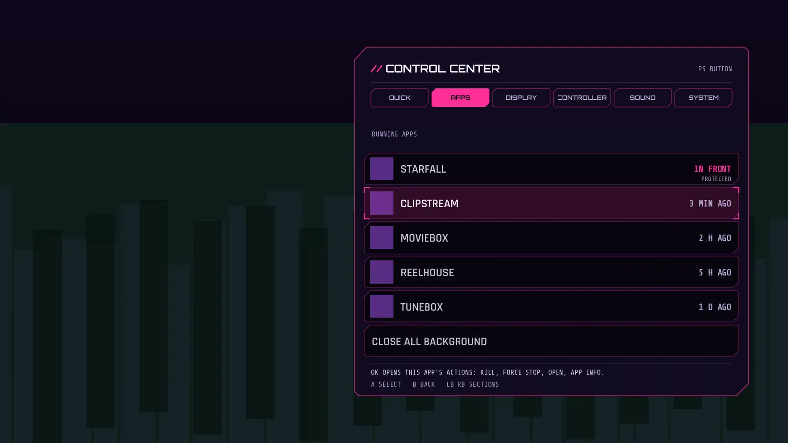

# Task manager

New in 2.8. The APPS section of the control center ([control-center.md](control-center.md)) lists the apps you used recently and can close them.



## The list

Each row has the app's icon, its name, how long ago you used it (NOW, 5 MIN AGO, 2 H AGO, 3 D AGO) and a mark for the app in front. Plain system apps and Visor itself are left out.

The list comes from Android's usage history, the same one the system recents source in Setup uses. It needs the one adb grant:

```
adb shell appops set com.nokoding.deck GET_USAGE_STATS allow
```

Without it the page says so and stays empty. Android does not let a normal app list other apps' processes (getRunningAppProcesses only returns Visor's own), so this is a list of recently used apps, not of running ones. Visor does not show memory per app, because Android does not give it to an app and Visor does not make numbers up. The DISPLAY section shows the whole box's free and total memory as Android reports it.

## Three ways to stop an app

OK on an app opens its actions, with OPEN first, so OK twice still switches to the app like the old recent apps list did. Only the actions that can work are shown.

1. **KILL BACKGROUND.** Android's killBackgroundProcesses, with the normal permission KILL_BACKGROUND_PROCESSES (granted at install). It ends the app's cached and background processes. It cannot end the app on screen, so it is not offered for the app in front. An app that holds a foreground service may start again by itself.
2. **FORCE STOP** (experimental). A normal app cannot force stop another app: that needs FORCE_STOP_PACKAGES, a signature permission nobody can grant with adb. So the overlay service does it like a person would: it opens the app's App Info page, finds the Force stop button and its confirm button, presses them and goes Home. It matches buttons by view id first and by text second, and gives up with a toast showing the adb line if the page looks different after about 10 seconds. It needs the overlay service on. Google TV's Settings differs between builds, so whether it works on the onn box is not known. It asks you to press OK twice.
3. **ADB.** SHOW ADB COMMAND shows the exact line, and from your phone:

```
bash deck/tools/force-stop.sh TVIP:PORT com.example.app
```

which runs only `am force-stop PACKAGE` after checking the package name (letters, digits, dots and underscores) and refuses Visor's own package. By hand: `adb shell am force-stop com.example.app`.

The other actions are OPEN, APP INFO, GAME PROFILE (see [game-profiles.md](game-profiles.md)) and PROTECT FROM CLOSE ALL.

## Close all background

CLOSE ALL BACKGROUND kills the background processes of every app on the list except the protected ones. The first press shows how many apps it would close and asks for a second press within four seconds.

Never closed: Visor, the system home app, the app in front, and any app you protect (an app's actions, PROTECT FROM CLOSE ALL, or Setup, SYSTEM, PS MENU, which can clear the list).

## What could not be checked

- Whether the FORCE STOP route works on this box's Settings.
- Whether killBackgroundProcesses frees anything useful on a 1.4 GB box, or whether Android restarts the apps at once.
- The usage list on the box: apps that Android never reports as used will not show.
