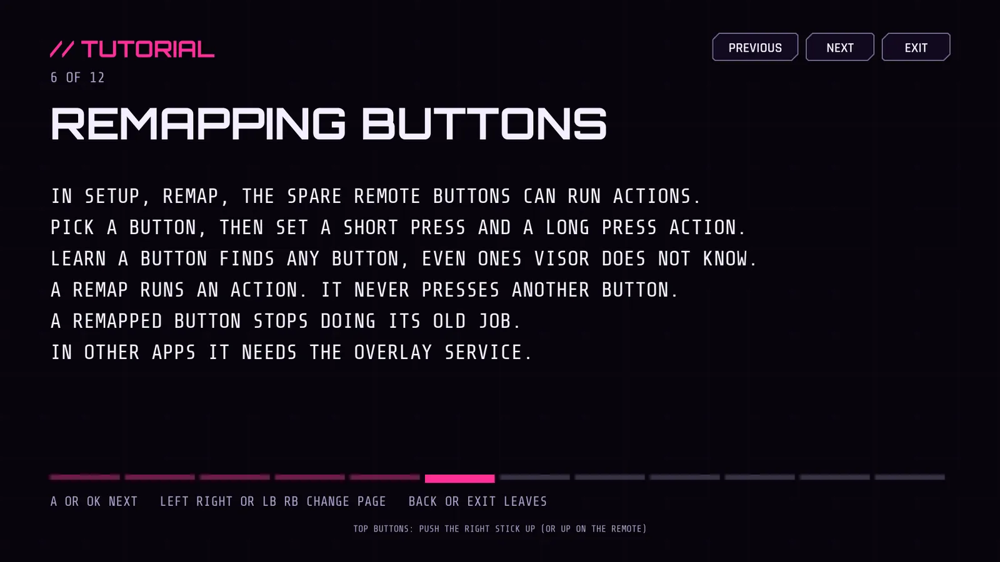

# The Visor tutorial

New in 2.9. A short set of full screen lessons that teaches the controls and the features, with a TRY IT step on some of them.

## Opening it

- The first time Visor starts after you install 2.9, it offers the tutorial by itself, once. Leaving it in any way (EXIT, Back, finishing) means it is not offered again. If you install over an older Visor you get it once too.
- Any time: Setup, SYSTEM, TUTORIAL. It continues at the first lesson you have not seen.
- From a phone: `adb shell am start -n com.nokoding.deck/.HomeActivity --es deck_cmd open_tutorial`

## Reading it from the couch

The text is big on purpose (40 design pixels for the lessons, 84 for the title, 54 for the TRY IT line, on a 1920x1080 screen), because a TV is read from a distance. A very long lesson shrinks a little instead of running into the TRY IT box. The note that a lesson is about a game controller sits at the top next to the lesson number, and the button hints stay on their own line at the bottom, so nothing overlaps.

## Moving through it

- A or OK: next lesson. B, left or L1: the one before. Right or R1: next.
- The chips top right do the same with a pointer, a stick or the D-pad: PREVIOUS, NEXT (FINISH on the last page) and EXIT.
- Back on the remote leaves. So does holding Start and Select for 2 seconds. Nothing behind the tutorial moves or launches while it is open.
- The bar under the text shows which lessons you have seen.

## TRY IT

Some lessons ask you to press something, such as OK, L1, the PS button, or two buttons together (HOLD X THEN PRESS Y). The screen sees the press and shows DONE. While a try step is waiting, the key it wants counts for the step and does not change the page, so you can try OK without skipping the lesson. After DONE the key moves the page again.

Nothing risky can be tried here. The lesson about getting out of trouble (hold Back for 6 seconds, hold the PS button for 4 seconds, RESTORE DISPLAY, RESET ALL REMAPS) has no try step, and says not to try those now.

## The lessons

1. Welcome to Visor. What Visor is and how the tutorial works.
2. Moving around. D-pad, OK, hold OK, Menu, Back.
3. The wheel and the grid. Y, the right stick, L1 and R1.
4. The PS menu. The control center, its sections, L1 and R1.
5. The task manager. The APPS section.
6. Remapping buttons. Setup, REMAP, LEARN A BUTTON.
7. Combos. Two buttons together, see [combos.md](combos.md).
8. If something goes wrong. The ways out, see [button-remap.md](button-remap.md) and [game-profiles.md](game-profiles.md).
9. Game profiles.
10. Touchpad volume.
11. Make it yours. Wallpapers, clock seconds, the screensaver and REDUCE EFFECTS.
12. That is it. Where to find this again.

The text is plain data (TutorialModel in the source), checked by tests for length and for the things it must say. Whether each statement is true on the onn box is the same as the feature it describes: the docs of each feature list what could not be checked.

## What could not be checked

- How the lessons read from the couch.
- Whether the PS button reaches the tutorial on this box (the PS try step). If the box swallows it, that one step cannot be completed, and NEXT still moves on.

## No try step can trap you (2.17)

The first press of a key that a TRY IT step waits for counts only for the step. Pressing the same key again moves the page, and A or D-pad right always move it. There is also a SKIP TRY chip that counts the step as done. A test goes through every lesson and checks that pressing R1 over and over always reaches the last page. The escape lesson now says to hold B for 1.5 seconds in the gamepad test.
