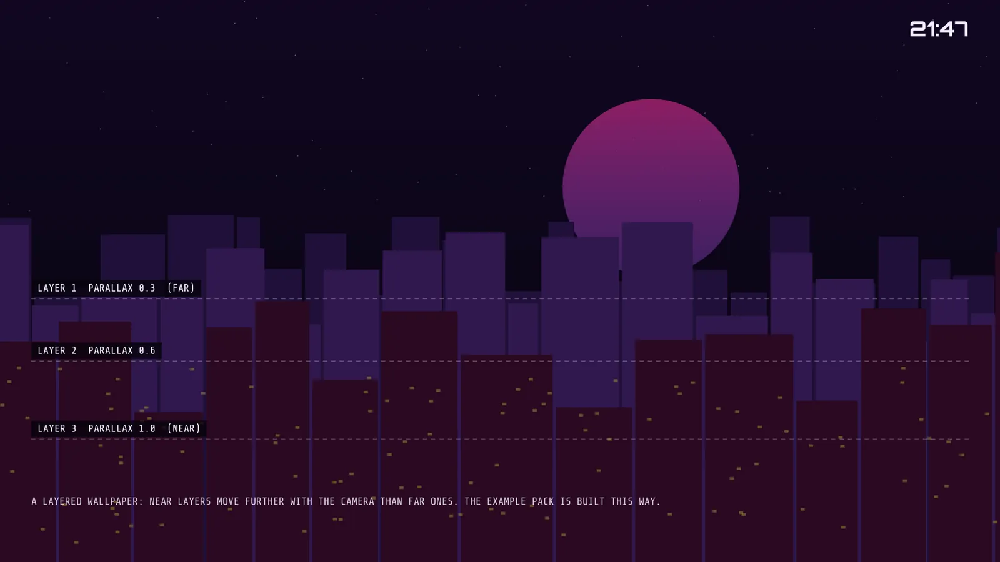

# Visor wallpapers

Visor's background is a procedural skyline that it draws itself. New in 2.7: you can swap it for your own picture, a stack of parallax layers, or a GIF or animated WebP. New in 2.17: an experimental looping video, and a page on your phone to send wallpapers to the TV. It works like sound packs and icon packs: a folder or a zip, the same safety rules, a Termux script and a reload command. The other two are in [sound-packs.md](sound-packs.md) and [icon-packs.md](icon-packs.md). The screensaver uses the same wallpaper, see [screensaver.md](screensaver.md).

Nothing changes unless you pick a wallpaper. The built-in skyline stays the default.



## Choosing one

Setup > LOOK has these rows:

| Row | What it does |
|---|---|
| WALLPAPER | BUILT-IN SKYLINE (default), one entry per pack found, or OFF (plain dark background, the cheapest). The pick shows live behind the Setup panel |
| WALLPAPER OPTIONS | The chosen pack's own options. Greyed out for the skyline and OFF |
| RELOAD WALLPAPERS | Unpacks new zips and rescans the folder |
| WALLPAPER FOLDER | Shows the folder path |
| WALLPAPER STATUS | Says what loaded, or why a pack was refused |

A bad pack never crashes Visor. The status line says what is wrong in plain capitals and Visor uses the built-in skyline.

## Where packs go

```
/sdcard/Android/data/com.nokoding.deck/files/wallpapers/<packname>/
/sdcard/Android/data/com.nokoding.deck/files/wallpapers/<packname>.zip
```

Visor creates the folder the first time it runs. Open Visor once before you push a pack.

## What a pack is

A folder with a `wallpaper.json` and the images it names. Allowed files: `wallpaper.json`, `.png`, `.jpg`, `.jpeg`, `.webp`, `.gif`, and for a video wallpaper one `.mp4`.

Limits: 8 MB per image, 24 MB per pack, 16 files (the JSON counts), 64 KB for wallpaper.json, 8 layers, 12 pack options. A pack with a video may hold one `.mp4` up to 40 MB and is limited to 48 MB.

Zips follow the same rules as sound packs: files at the root of the zip (the pack is named after the zip) or all inside one folder (named after the folder), a path that tries to leave the folder refuses the whole zip, one pack per zip, a hidden temp folder renamed into place at the end, and a `.deck-source` marker so the same zip is not unpacked twice. Pushing a changed zip with the same name installs it over the old one.

## wallpaper.json

Four types. Unknown keys are ignored. A bad number falls back to its default. `"format": 1` is the current version.

### image

One picture.

```json
{ "format": 1, "name": "Rainy Street", "author": "you", "version": "1.0",
  "type": "image", "file": "street.jpg" }
```

### layers

A stack of images drawn back to front. Each layer moves with Visor's pan camera by its own amount, which gives depth.

| Key | Meaning |
|---|---|
| file | The image |
| parallax | 0.0 to 2.0. How far the layer moves with the camera. Far layers small, near layers big |
| scale | 1.0 to 3.0. Zoom of the layer. Keep it high enough that the edges never show at the largest pan. Visor also clamps the move so an edge never shows |
| opacity | 0.0 to 1.0 |
| tint, tintMix | A color and how much of it to mix in |
| when | `"key=VALUE"`, show the layer only when a CHOICE or BOOL option has that value |

Any layer number can be `"@key"` to follow one of your options, and `tint` can be `"@key"` to follow a COLOR option. The example pack does all of this.

### animated

A GIF or an animated WebP.

```json
{ "format": 1, "name": "Rain Loop", "type": "animated", "file": "rain.gif", "fps": 20, "speed": 1.0 }
```

fps is 5 to 30 (default 20). speed is 0.25 to 1.0.

## Options

Visor adds these to every pack by itself: PARALLAX STRENGTH (0 to 200 percent), PAN SPEED (0 to 200), DIM (0 to 80, keeps the UI readable), TINT (mixes in the accent color) and ZOOM (100 to 150). Animated packs also get PLAYBACK SPEED (25 to 100) and FRAME RATE CAP (5 to 30).

Your pack can add its own in an `options` list, in the same style as animation options from 2.3: `key`, `label`, `type` (CHOICE, INT_RANGE, FLOAT_RANGE, BOOL or COLOR), `min`, `max`, `step`, `default`, `choices`, `unit`. The keys `parallax`, `pan`, `dim`, `tint`, `zoom`, `speed` and `fps` are reserved. A pack cannot reuse them.

The example pack in [examples/wallpaper-example](examples/wallpaper-example/wallpaper.json) has a CHOICE (mood), a FLOAT_RANGE (glow), a BOOL (stars), a COLOR (glow color) and an INT_RANGE (depth).

## Install from your phone

With Termux and adb connected to the TV (see [guide-termux.md](guide-termux.md)):

```
bash deck/tools/install-wallpaper.sh 192.168.1.50:37425 mypack.zip
bash deck/tools/install-wallpaper.sh 192.168.1.50:37425 mypack/
```

The script checks the name, the size limits and the file types before it pushes anything, then pushes and tells Visor to reload. It was only run against a fake adb, with good and bad input, not against a real TV.

By hand:

```
adb push mypack /sdcard/Android/data/com.nokoding.deck/files/wallpapers/
adb shell am start -n com.nokoding.deck/.HomeActivity --es deck_cmd reload_wallpapers
```

Or open Setup > LOOK > RELOAD WALLPAPERS.

## How it is drawn, and the memory

The box has 1.4 GB of RAM in total, so Visor keeps one decoded wallpaper at a time and frees it when you leave.

- Still images and layers are decoded with `inSampleSize` to a width near the screen width times 1.15, as RGB_565 when the image has no transparency. Visor works out the decoded size first and refuses a pack that would need more than 32 MB.
- Animated images use Android's ImageDecoder and AnimatedImageDrawable at 1280x720 or smaller, with about 24 MB for the frames. If that does not fit, you get the first frame as a still picture. The frame rate is capped by FRAME RATE CAP (default 20) and it stops when Visor is not visible.
- PLAYBACK SPEED only slows an animation down. It does so by stopping and starting the player in a short cycle. That may look steppy. It has not been seen on a screen.
- Reduce effects: the first frame only, no parallax, no animation.

## Video wallpapers (2.17, experimental)

```json
{ "format": 1, "name": "City Loop", "type": "video", "file": "loop.mp4" }
```

A video wallpaper is **off unless you pick it**, like every wallpaper. It is one muted, looping `.mp4` (H.264) played by Android's MediaPlayer on a TextureView behind the wallpaper. The parallax camera moves and scales it like an image. The wallpaper options (parallax, pan speed, dim, tint, zoom) work. PLAYBACK SPEED and FRAME RATE CAP do not apply to video.

Hard limits, checked from the file's header before anything plays. A video over any of them is refused and WALLPAPER STATUS says which:

| Limit | Value |
|---|---|
| Size | 1280x720 at most (a turned portrait file is judged after the turn) |
| Frame rate | 30 fps at most |
| Bit rate | 6 Mbit/s at most |
| File | 40 MB at most |
| Length | 0.5 seconds to 5 minutes |

When it plays:

- Only while Visor is in front. When a game or any other app is in front, or Visor is paused, the player is released, so no decoder is held in the background. It starts again when you return, which takes a moment.
- Never under Reduce effects: you get the video's first frame as a still picture.
- One video at a time. Changing wallpaper stops the old one.
- The screensaver shows the first frame, not the video.
- On any error (a codec the box cannot decode, a corrupt file) the player stops quietly and the first frame stays as a still picture.

Honest notes: the box has 1.4 GB of RAM and a weak GPU. The hardware decoder should handle 720p H.264 without much memory, but nothing in 2.17 has run on the TV, so memory use, smoothness, how long it takes to start, and whether the dim sits correctly on top are all unknown. Try a short, small file first.

## Sending wallpapers from your phone's browser (2.17)

Install the Termux packages once: `pkg install -y python android-tools`. Then:

```
bash deck/tools/wallpaper-web.sh 192.168.1.50:37425
```

It prints an address such as `http://127.0.0.1:8765/?t=abc123`. Open that in your phone's browser, pick a file (`.mp4`, `.gif`, `.png`, `.jpg`, `.webp`, or a pack `.zip`) and tap SEND. The script checks the name and the size, wraps a single file into a small pack with a `wallpaper.json`, pushes it with adb into the wallpapers folder, and tells Visor to reload (`deck_cmd reload_wallpapers`). Then pick it in Setup, LOOK, WALLPAPER.

Why the page is on the phone and not on the TV: a web page served by the TV would need the INTERNET permission in Visor, and Visor does not have that permission and keeps it that way. The page listens on 127.0.0.1 only, so nothing else on your network can reach it, and it needs the random token from the address. Only the phone browser that opened the address can send files.

The script never uses a path from the page. It keeps only the base name, which must be letters, digits, space, dot, dash and underscore, and refuses other file types and files over the limit (the size is checked before the file is read). Other apps on the phone could still reach 127.0.0.1, which is why the token is there. It was tested with a fake adb and curl (good upload, wrong token, a path in the name, a bad type, an oversize claim), not against a real TV.

## Making a pack

1. Make 1920x1080 images. For layers, make the far ones sky, the near ones buildings or trees, with transparent PNG on the near layers so you see through them.
2. Put them in a folder with a wallpaper.json. Copy the example and change it.
3. Zip it (files at the root) or push the folder.
4. Setup > LOOK > RELOAD WALLPAPERS, then pick it in WALLPAPER.

## Troubleshooting

- The pack is not in the list: RELOAD WALLPAPERS. Check the folder is under `files/wallpapers/` and the name has only letters, digits, space, dot, dash and underscore.
- WALLPAPER STATUS says a file is missing: the name in wallpaper.json has to match the file exactly, including capitals.
- TOO BIG FOR THIS BOX: shrink the image. 1920x1080 is plenty.
- A GIF shows one still frame: Reduce effects may be on (Setup > MOTION), or the animation was too big to decode.
- A video shows one still frame: Reduce effects is on, or Android could not play the file. Re-encode it as H.264 at 1280x720 or less.
- It looks too bright and the menu is hard to read: raise DIM in WALLPAPER OPTIONS.
